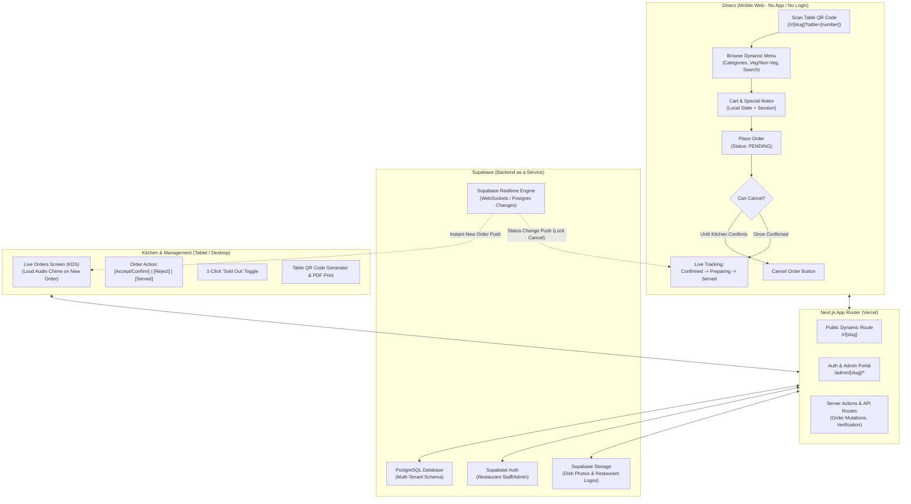
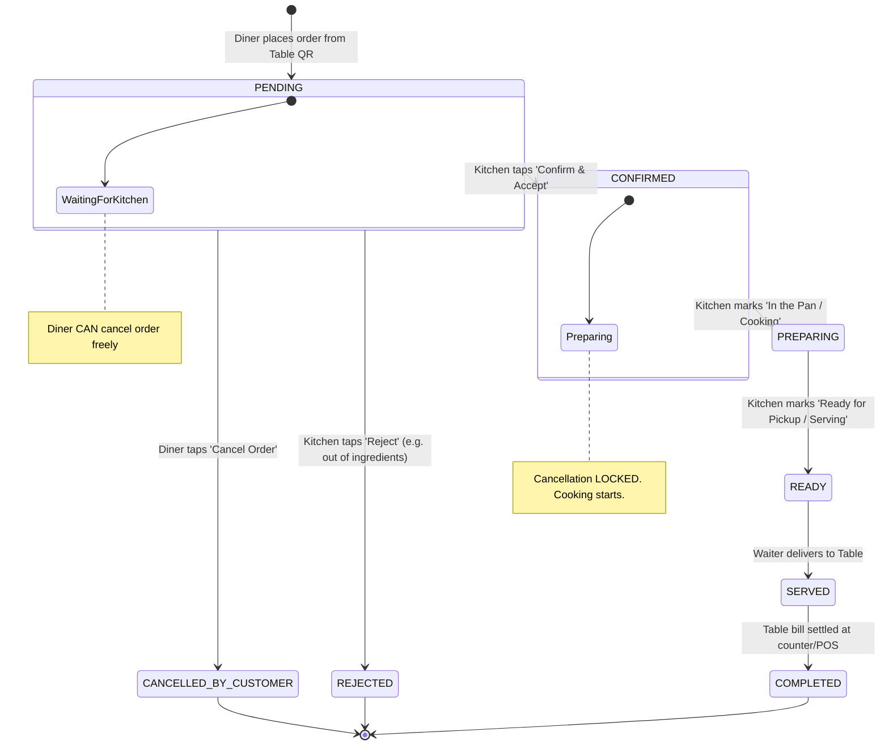
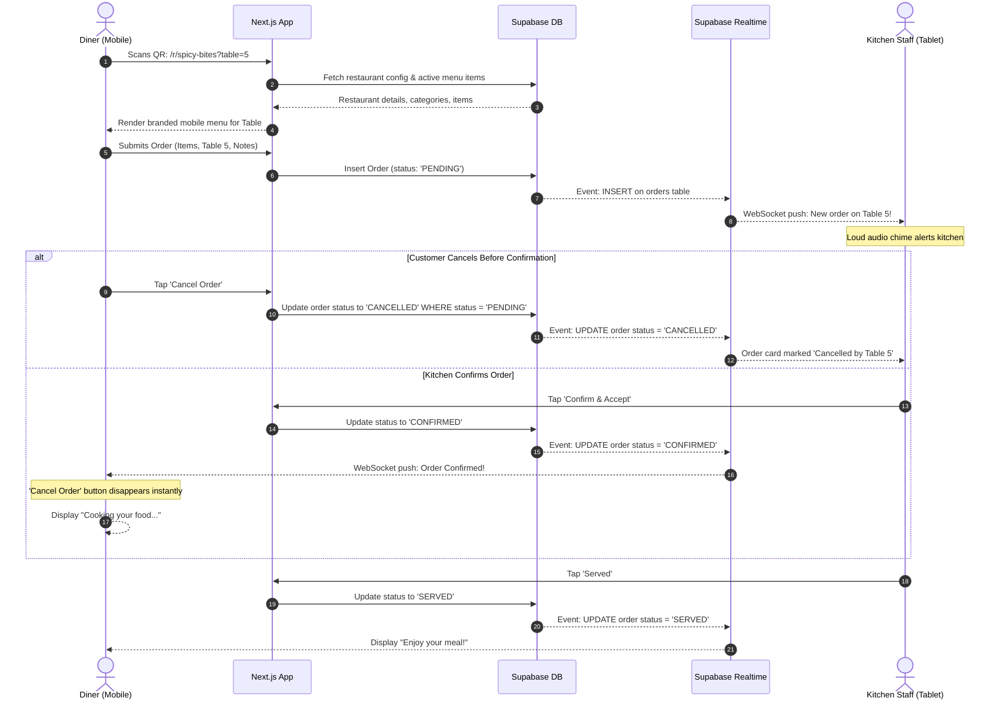
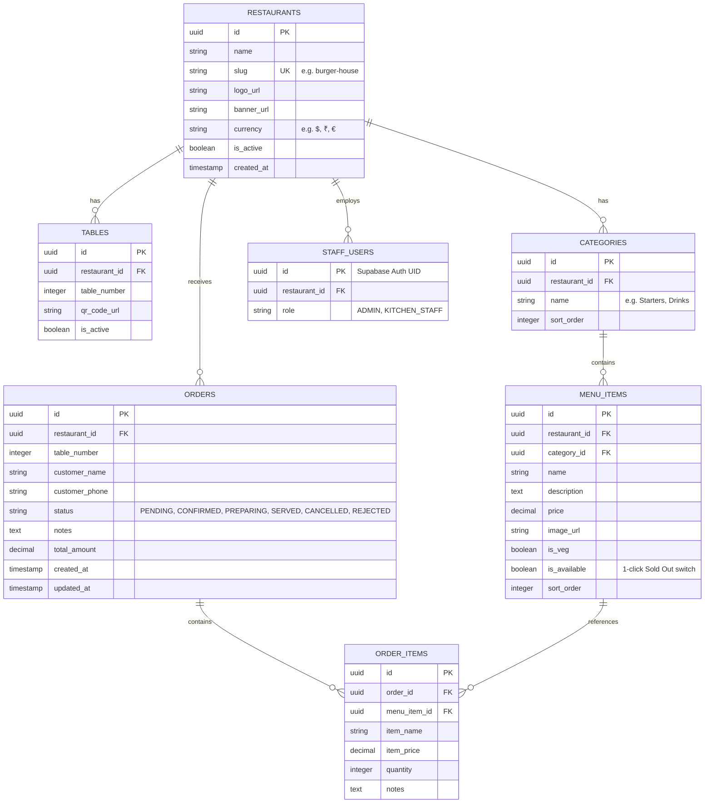

# Multi-Tenant QR-Code Restaurant Ordering System
## Architecture & Technical Specification Document

---

## 1. Executive Overview

This system is a **Multi-Tenant SaaS platform** enabling dining establishments to offer instant, frictionless table-side ordering via dynamic QR codes. 

* **Diners** scan a table-specific QR code, view the live digital menu, customize items, and place orders directly from their mobile browser without downloading an app or registering an account.
* **Kitchen Staff / Managers** receive orders in real time on a dedicated dashboard with audible chimes, update order statuses, manage live menu item availability, and generate printable table QR codes.
* **Tenancy Model:** Every restaurant is completely isolated with its own URL slug, branding, menu, tables, and staff credentials.

---

## 2. High-Level System Architecture



---

## 3. Order Lifecycle & Cancellation State Machine

The cancellation window is strictly enforced on both the client UI and the database level:



---

## 4. End-to-End Sequence Diagram



---

## 5. Database Schema (PostgreSQL on Supabase)

Multi-tenancy is enforced via `restaurant_id` across all relational tables:



---

## 6. Page & Routing Structure

```
src/
├── app/
│   ├── (customer)/
│   │   └── r/[slug]/
│   │       ├── page.tsx               <-- Diner menu (/r/my-cafe?table=3)
│   │       └── order/[orderId]/
│   │           └── page.tsx           <-- Live order status & cancel screen
│   │
│   ├── (admin)/
│   │   └── admin/
│   │       ├── login/                 <-- Staff / Manager login
│   │       └── [slug]/
│   │           ├── live-orders/       <-- Kitchen Display Screen (Audio alerts + Kanban)
│   │           ├── menu/              <-- Add/edit dishes & 'Sold Out' toggles
│   │           ├── tables/            <-- Table manager & batch QR PDF generator
│   │           └── settings/          <-- Restaurant branding, name, currency
│   │
│   └── api/                           <-- API endpoints for webhooks / printing
```

---

## 7. Key Operational Features

### A. Frictionless Customer Experience
1. **Zero Registration:** Diner scans and immediately sees the menu for their specific table.
2. **Veg / Non-Veg Filters:** One-tap toggle on the menu header.
3. **Session Persistence:** Active orders stored in `localStorage` + URL query parameters so accidental refresh never loses order status.
4. **Order Stacking:** Diners can place a 2nd or 3rd round of orders (drinks, dessert) to the same table.

### B. Kitchen Display System (KDS)
1. **Audible Chime Alert:** Web Audio API sound loop triggers continuously on new `PENDING` orders until staff acknowledges.
2. **Visual Urgency:** Color-coded order cards that show elapsed time (e.g., yellow for < 2 min, orange for > 5 min).
3. **Large High-Contrast Buttons:** Designed for grease/busy kitchen tablet screens.

### C. Printable QR Codes
1. One-click generation of high-resolution vector/canvas QR cards.
2. Each card clearly prints:
   - Restaurant Name & Logo
   - Prominent **Table #[Number]** badge
   - "Scan camera to order" instruction

---

## 8. Implementation Phases

1. **Phase 1: Project Setup & Database Foundations**
   - Initialize Next.js 14/15 with Tailwind CSS and Lucide icons.
   - Configure Supabase client and establish Postgres database tables with multi-tenant foreign keys.
2. **Phase 2: Customer Mobile Ordering UI**
   - Build dynamic menu layout (`/r/[slug]?table=X`).
   - Implement Cart drawer, dietary tags (Veg/Non-Veg), and order checkout.
   - Implement customer live tracking screen with dynamic cancellation button.
3. **Phase 3: Kitchen Display & Real-Time Sync**
   - Setup Supabase Realtime subscriptions for instantaneous order insertion and status updates.
   - Implement Web Audio chime alarm for incoming orders.
   - Add status mutation controls (`Confirm`, `Cancel`, `Served`, `Reject`).
4. **Phase 4: Restaurant Admin & Menu Management**
   - Menu CRUD interface with instant "Sold Out" availability toggles.
   - Table management and QR Code generator/print utility.
   - Multi-tenant settings (restaurant branding and currency).
